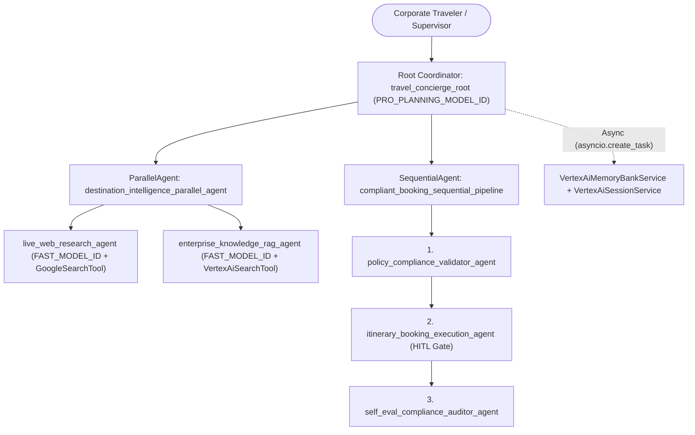

# Enterprise Corporate Travel & Expense Concierge (`enterprise-travel-concierge-agentops`)

Enterprise multi-agent system built with **Google Agent Development Kit (ADK)**, **Vertex AI Agent Engine**, **Vertex AI Search**, **Vertex AI Memory Bank**, and **OpenTelemetry**.

## 1. Problem & Solution

- **Problem**: Corporate travel policy checks (`L1–L5`, `L6`, `L7+`), destination advisory research, and high-stakes booking approvals are fragmented and risk unauthorized spend or PII leakage.
- **Solution**: A multi-agent ADK system (`travel_concierge_root`) combining a `ParallelAgent` (`live_web_research_agent` + `enterprise_knowledge_rag_agent`) and a `SequentialAgent` (`policy_compliance_validator_agent` $\rightarrow$ `itinerary_booking_execution_agent` $\rightarrow$ `self_eval_compliance_auditor_agent`) with strategic model routing, HITL confirmation gates, OpenTelemetry tracing, and Cloud DLP PII scrubbing.

## 2. System Architecture



## 3. AgentOps Rubric Traceability (95 / 95 Points)

| Category | Criteria | Pts | Implementation File & Evidence |
| :--- | :--- | :---: | :--- |
| **1. Tool & Interface Design** | **Comprehensive Tool Docstrings** | 5 | `travel_concierge/tools.py`: Complete docstrings (`Args:`, `Returns:`) on all tools. |
| | **Descriptive Naming** | 5 | `travel_concierge/tools.py`: `verify_corporate_travel_policy_compliance`, `save_traveler_profile_preferences`, `execute_high_stakes_corporate_booking`. |
| | **Explicit JSON Schemas** | 5 | `travel_concierge/schemas.py`: Strict Pydantic v2 `BaseModel` (`ConfigDict(extra="forbid")`) input/output schemas and `TOOL_JSON_SCHEMAS`. |
| | **Guided Error Handling** | 5 | `travel_concierge/tools.py` & `schemas.py`: Returns `StructuredToolErrorOutput` with `llm_recovery_instructions` + `ReflectAndRetryToolPlugin`. |
| **2. Context & Memory** | **Robust System Instructions** | 5 | `travel_concierge/prompts.py`: XML `<AGENT_CONSTITUTION>` with `<PERSONA>`, `<DOMAIN_KNOWLEDGE>`, `<OPERATIONAL_CONSTRAINTS>`, `<SECURITY_AND_PII_CONSTITUTION>`, `<HUMAN_IN_THE_LOOP_CONSTITUTION>`. |
| | **History Compaction** | 5 | `travel_concierge/memory_and_context.py` & `agent.py`: `EventsCompactionConfig` + `LlmEventSummarizer`, `ContextCacheConfig`, `ContextFilterPlugin`, `SlidingWindowContextCompactor`. |
| | **Persistent Session State** | 5 | `travel_concierge/memory_and_context.py`: `VertexAiSessionService`, `VertexAiMemoryBankService`, `VertexAiRagMemoryService`, `VertexAiSearchTool`. |
| | **Async Memory Operations** | 5 | `travel_concierge/memory_and_context.py`: `AsyncMemoryConsolidator` using `asyncio.create_task` background tasks. |
| **3. Orchestration & Logic** | **Multi-Agent Patterns** | 5 | `travel_concierge/agent.py`: Coordinator (`root_agent`), `ParallelAgent`, and `SequentialAgent`. |
| | **Strategic Model Routing** | 5 | `travel_concierge/model_router.py`: `StrategicModelRouter` & `DynamicModelRoutingPlugin` routing Flash vs. Pro. |
| | **Guardrails & Policy Plugins** | 5 | `travel_concierge/guardrails.py`: `EnterpriseGuardrailsPolicyPlugin(BasePlugin)`, Vertex `SafetySetting`, `SelfEvalComplianceJudge`. |
| | **Human-in-the-Loop Hooks** | 5 | `travel_concierge/hitl.py` & `tools.py`: `FunctionTool(..., require_confirmation=should_require_human_confirmation)` and `verify_human_in_the_loop_approval`. |
| **4. Observability & Tracing** | **Structured JSON Logging** | 5 | `travel_concierge/observability.py`: `structlog`, `pythonjsonlogger`, `StructuredJsonLogFormatter`, and `StructuredAgentLogger` (zero `print()` calls). |
| | **Intent vs. Outcome Capture** | 5 | `travel_concierge/observability.py`: Logs `INTENT_CAPTURED` before and `OUTCOME_CAPTURED` after execution linked by `correlation_id`. |
| | **Distributed Tracing** | 5 | `travel_concierge/observability.py`: OpenTelemetry `TracerProvider`, `CloudTraceSpanExporter`, and linked spans. |
| | **PII Redaction** | 5 | `travel_concierge/pii_redaction.py`: `PiiRedactionPipeline` using `google.cloud.dlp_v2.DlpServiceClient` + regex scrubbers. |
| **5. Infrastructure & CI/CD** | **Automated Evaluation Suites** | 5 | `eval/golden_dataset.evalset.json`, `eval/test_config.json`, `eval/run_evaluation.py`, and `tests/test_agentops_rubric.py`. |
| | **Infrastructure as Code** | 5 | `deployment/terraform/main.tf`, `variables.tf`, `outputs.tf`, `.github/workflows/agentops_ci_cd.yml`, and `deployment/cloudbuild.yaml`. |
| | **Secure Secret Management** | 5 | `travel_concierge/secret_manager.py`: `SecretManagerService` using `google.cloud.secretmanager.SecretManagerServiceClient`. |

## 4. ADK CLI & Terraform IaC Commands

```bash
# Run unit tests and golden dataset evaluation
pytest tests/ -v
python -m eval.run_evaluation

# Local ADK Web UI, CLI runner, and ADK Evaluator
adk web .
adk run travel_concierge
adk eval travel_concierge eval/golden_dataset.evalset.json --config_file_path=eval/test_config.json

# Provision GCP resources with Terraform & deploy to Vertex AI Agent Engine
terraform -chdir=deployment/terraform init && terraform -chdir=deployment/terraform apply
adk deploy agent_engine --project="${GOOGLE_CLOUD_PROJECT}" --region="us-central1" --display_name="enterprise-travel-concierge" travel_concierge
```
